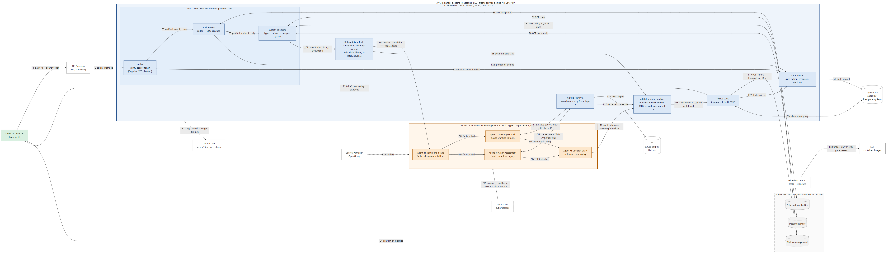

# ClaimSense AI: Architecture

Milestone 2. A first pass on one claim runs left to right. Blue boxes are **deterministic code**:
exact, tested, and never delegated to a model. Orange boxes are **model judgment**: typed, and
every judgment cited. Green is the **licensed adjuster**, who confirms every outcome. Gray dashed boxes
are the **client's systems**, simulated with synthetic fixtures in this pilot. Every AWS component is
**planned, pending the IK account** (D-012); until then the same containers run locally.

**What runs today (Milestone 3):** all four agents, retrieval, the guardrails, the fallback and the
idempotent write, in containers, started by `docker compose up --build`. Identity is a placeholder
header until Milestone 4 (D-023). The audit log is in memory, and retrieval is local BM25 over the
fixture corpus rather than S3 (D-019).

```mermaid
flowchart LR
  ADJ["Licensed adjuster<br/>browser UI"]:::human
  CI["GitHub Actions CI<br/>tests + eval gate"]:::infra

  subgraph AWS["AWS: planned, pending IK account (ECS Fargate service behind API Gateway)"]
    direction LR
    APIGW["API Gateway<br/>TLS, throttling"]:::infra
    subgraph DET["DETERMINISTIC CODE: Python, exact, unit-tested"]
      direction TB
      subgraph DAS["Data-access service: the one governed door"]
        direction TB
        AUTHN["AuthN<br/>verify bearer token<br/>(Cognito JWT, planned)"]:::det
        ENT["Entitlement<br/>caller == CMS assignee"]:::det
        ADAPT["System adapters<br/>typed contracts, one per system"]:::det
      end
      CALC["Deterministic facts<br/>policy term, coverage present,<br/>deductible, limits, TL ratio, payable"]:::det
      RET["Clause retrieval<br/>search corpus by form, top-k"]:::det
      VAL["Validator and assembler<br/>citations in retrieved set,<br/>DENY precedence, output scan"]:::det
      WB["Write-back<br/>idempotent draft POST"]:::det
      AUD["Audit writer<br/>user, action, resource, decision"]:::det
    end
    subgraph MOD["MODEL JUDGMENT: OpenAI Agents SDK, strict typed output, every judgment cited"]
      direction TB
      A1["Agent 1: Document Intake<br/>facts + document citations"]:::model
      A2["Agent 2: Coverage Check<br/>clause wording vs facts"]:::model
      A3["Agent 3: Claim Assessment<br/>fraud, total loss, injury"]:::model
      A4["Agent 4: Decision Draft<br/>outcome + reasoning"]:::model
    end
    DDB[("DynamoDB<br/>audit log,<br/>idempotency keys")]:::infra
    S3[("S3<br/>clause corpus,<br/>fixtures")]:::infra
    CW["CloudWatch<br/>logs, p95, errors, alarm"]:::infra
    SM["Secrets Manager<br/>OpenAI key"]:::infra
    ECR["ECR<br/>container images"]:::infra
  end

  subgraph CLIENT["CLIENT SYSTEMS: synthetic fixtures in the pilot"]
    direction TB
    CMS[("Claims management")]:::client
    PAS[("Policy administration")]:::client
    DOCS[("Document store")]:::client
  end
  OAI["OpenAI API<br/>subprocessor"]:::ext

  ADJ -->|"F1 claim_id + bearer token"| APIGW
  APIGW -->|"F2 token, claim_id"| AUTHN
  AUTHN -->|"F3 verified user_id, role"| ENT
  ENT <-->|"F4 GET assignment"| CMS
  ENT -->|"F5 granted: claim_id only"| ADAPT
  ADAPT <-->|"F6 GET claim"| CMS
  ADAPT <-->|"F7 GET policy as_of loss date"| PAS
  ADAPT <-->|"F8 GET documents"| DOCS
  ADAPT -->|"F9 typed Claim, Policy, Documents"| CALC
  CALC -->|"F10 dossier: one claim, figures fixed"| A1
  A1 -->|"F11 facts, cited"| A2
  A1 -->|"F11 facts, cited"| A3
  A2 <-->|"F12 clause query / hits with clause IDs"| RET
  A3 <-->|"F12 clause query / hits with clause IDs"| RET
  RET <-->|"F13 read corpus"| S3
  A2 -->|"F14 coverage reading"| A4
  A3 -->|"F14 risk indicators"| A4
  A4 -->|"F15 draft outcome, reasoning, citations"| VAL
  CALC -->|"F16 deterministic facts"| VAL
  RET -->|"F17 retrieved clause IDs"| VAL
  VAL -->|"F18 validated draft, model or fallback"| WB
  WB -->|"F19 POST draft + Idempotency-Key"| CMS
  WB -->|"F20 draft, reasoning, citations"| ADJ
  ADJ -->|"F21 confirm or override"| CMS
  AUTHN -->|"F22 denied: no claim data"| AUD
  ENT -->|"F22 granted or denied"| AUD
  WB -->|"F22 draft written"| AUD
  AUD -->|"F23 audit record"| DDB
  WB <-->|"F24 idempotency key"| DDB
  MOD <-->|"F25 prompts + synthetic dossier / typed output"| OAI
  SM -.->|"F26 API key"| MOD
  DET -.->|"F27 logs, metrics, stage timings"| CW
  CI -->|"F28 image, only if eval gate passes"| ECR

  classDef det fill:#dbe8f7,stroke:#1f4e8c,color:#0b1f3a
  classDef model fill:#fde7cc,stroke:#b35c00,color:#3d2000
  classDef human fill:#d9f0e1,stroke:#1d7a46,color:#0b2e1a
  classDef client fill:#f2f2f2,stroke:#777,color:#222,stroke-dasharray:4 3
  classDef infra fill:#ffffff,stroke:#999,color:#333
  classDef ext fill:#ffffff,stroke:#999,color:#333,stroke-dasharray:4 3
  style DET fill:#eef4fb,stroke:#1f4e8c,stroke-width:3px
  style DAS fill:#e3eefa,stroke:#1f4e8c
  style MOD fill:#fff6eb,stroke:#b35c00,stroke-width:3px
  style CLIENT fill:#fafafa,stroke:#777,stroke-dasharray:6 4
  style AWS fill:#ffffff,stroke:#bbb,stroke-dasharray:8 4
```

## The boundary, and why it sits there

| Deterministic code (blue) | Model judgment (orange) |
|---|---|
| Identity: verifying the caller's token | Reading the file: extracting facts from narrative and documents, each with a document citation |
| Entitlement: the caller is the CMS assignee, checked **before any agent runs** (D-003) | Coverage interpretation: whether a clause's wording applies to these facts, citing retrieved clause IDs |
| Policy dates: in term from term dates and transactions, never the status field (D-004) | Risk: fraud indicators from narrative consistency across documents, plus total-loss and injury exposure |
| Money: deductibles, limits, total-loss ratio, payable amount (D-001) | Drafting: the outcome and the reasoning an adjuster and an auditor can check |
| Citation validation: only retrieved clause IDs survive (D-005) | |
| Outcome precedence, DENY > ROUTE > FLAG > APPROVE, applied in code (D-002) | |
| Audit: every call, granted or denied, with user, action and resource | |
| Idempotent write-back of the draft (D-009) | |

**The rule for the line.** If a wrong answer is a legal or financial error and the answer is a
comparison or an arithmetic result, it is code. If the answer needs the wording read, it is the model,
and the model must cite what it read. A model never sees a claim the caller isn't entitled to,
because the entitlement check runs before the dossier exists.

**The agents have no tools that reach the client systems (D-010).** The deterministic pipeline fetches
one claim's dossier and hands it over with the figures fixed. The only tool, held by Coverage Check and Claim Assessment, is clause
retrieval, which searches policy wording and returns no claim data. A prompt injection in a document
(EV-002, EV-008, EV-018) can therefore, at most, search the clause corpus. It cannot fetch another
claim, change a figure, or mark a draft final.

**Fallback is labeled.** If an agent times out or returns output that fails its schema, the assembler
returns a deterministic fallback outcome, which can only be DENY on a term or coverage failure or FLAG
for adjuster handling. It is labeled `verdict_source: deterministic_fallback`, so it is never mistaken for a
model verdict and it counts as a miss in decision accuracy.

## Data flows

| Flow | From → to | Data | Notes |
|---|---|---|---|
| F1 | Adjuster → API Gateway | claim_id, bearer token | TLS; no claim data in the request |
| F2–F3 | Gateway → AuthN → Entitlement | token, then verified user_id and role | an invalid token stops at AuthN (F22) |
| F4 | Entitlement ↔ CMS | assignment record | the source of truth for entitlement |
| F5 | Entitlement → adapters | claim_id only, once granted | denied requests never reach F6–F8 |
| F6–F8 | Adapters ↔ CMS, PAS, document store | Claim, Policy as of loss date, Documents | typed contracts ([contracts.md](contracts.md)); read-only |
| F9 | Adapters → deterministic facts | validated models | unknown fields are rejected at this edge |
| F10 | Facts → Agent 1, Document Intake | dossier for one claim, figures fixed | document text is marked as quoted evidence |
| F11 | Document Intake → Coverage Check and Claim Assessment | facts, each with doc citations | Agents 2 and 3 run in parallel (R5) |
| F12–F13 | Coverage Check and Claim Assessment ↔ retrieval ↔ S3 | query, then clause hits | form-scoped; returns policy wording only |
| F14 | Coverage Check and Claim Assessment → Decision Draft | coverage reading, risk indicators | |
| F15–F17 | Decision Draft, facts, retrieval → validator | draft, deterministic facts, retrieved IDs | validator drops unretrieved citations and applies precedence |
| F18 | Validator → write-back | validated draft with `verdict_source` | model or deterministic fallback |
| F19 | Write-back → CMS | `POST /claims/{id}/recommendations` | the only write; Idempotency-Key = claim_id:run_id |
| F20 | Write-back → adjuster | draft, reasoning, citations, deterministic facts | judgment and computation shown separately |
| F21 | Adjuster → CMS | confirm or override, with reason | the CMS emits `AdjusterDecisionEvent`; criterion 3 and the bonus are counted here |
| F22–F23 | AuthN, entitlement, write-back → audit → DynamoDB | user, action, resource, decision, timestamp | append-only; refusals included |
| F24 | Write-back ↔ DynamoDB | idempotency key, body fingerprint, stored response | conditional write; replay returns the original |
| F25 | Agents ↔ OpenAI API | prompts and synthetic dossier, typed output | synthetic data only; the OpenAI API is a subprocessor |
| F26 | Secrets Manager → agents | API key | never in code, image or `.env` committed |
| F27 | Service → CloudWatch | logs, request metrics, per-stage timings | dashboard: error rate, volume, p95; one alarm |
| F28 | CI → ECR | container image | pushed only if the eval gate passes |

## Planned AWS components (pending IK account)

| Component | Role | Why this one |
|---|---|---|
| API Gateway (HTTP API) | public entry, TLS, throttling | managed; per-route throttling helps with R2 |
| ECS Fargate | runs the service container | long agent calls (up to 90 s) without Lambda's cold starts or timeout tuning |
| ECR | container registry | CI pushes here only after the eval gate passes |
| Cognito user pool | issues the bearer tokens AuthN verifies | managed identity; two synthetic adjusters for the two-user test |
| DynamoDB | audit log, idempotency keys | conditional writes implement the idempotency rule directly |
| S3 | clause corpus and fixtures | versioned bucket; a corpus update is a new version |
| Secrets Manager | OpenAI key | key never in the image |
| CloudWatch | logs, metrics, dashboard, alarm | brief Milestone 5 dashboard and alarm |

All are in the default service quotas (R2). Until the account exists, Docker Compose runs the same
service with local stand-ins: a local JWT issuer, SQLite for the audit log and idempotency keys, and
the fixtures from the file system.

## Stack choice

The brief fixes the stack: OpenAI Agents SDK for typed, verifiable output, AWS for hosting, a
searchable clause corpus, containers, and CI with an eval gate. The notebook's lesson that "stack
follows the client" applies: the client's estate is AWS here.

## Alternatives considered and rejected

| Alternative | Why rejected | Revisit when |
|---|---|---|
| **One agent doing the whole adjudication** | Can't attribute an error to a stage, can't run coverage and risk in parallel, and one prompt mixes reading with drafting. Four typed agents give four testable outputs. | Never for the pilot |
| **Access control as a model instruction** ("only discuss the assigned claim") | A prompt isn't a control; the rubric rates it Weak (area D) | Never |
| **Agents call the client systems through tools or an MCP server** | The Week 14 reference puts a governed MCP door between agents and systems. Here the agents need one known claim, so pre-fetching it is strictly safer: no tool exists to fetch another record. It also removes a round trip per tool call from the latency budget. (D-010) | Agents need to pull documents the dossier can't anticipate |
| **Extend the client's rule table** | Rules read fields; coverage and fraud need the wording and cross-document consistency read (D-001, charter) | A judgment step proves fully expressible as a rule; then it moves into code |
| **Managed vector database (OpenSearch) for the corpus** | Tens of clauses per form: an in-process index over S3 is enough, and has no cluster to provision inside an unknown IK quota (R2) | The corpus grows past a few thousand clauses, or needs hybrid search |
| **Lambda instead of Fargate** | 4 sequential model calls approach the timeout margin, and cold starts eat into the p95 budget | Traffic is bursty enough that idle Fargate cost matters |
| **Asynchronous queue (SQS) with a callback** | The 90 s target allows a synchronous call, and a queue adds a second failure mode before Milestone 4 | p95 can't be met synchronously, or volume needs smoothing |
| **Trusting the PAS status field** | It reproduces the client's paid-on-a-lapsed-policy bug (D-004) | The client shows a case where status is authoritative |
