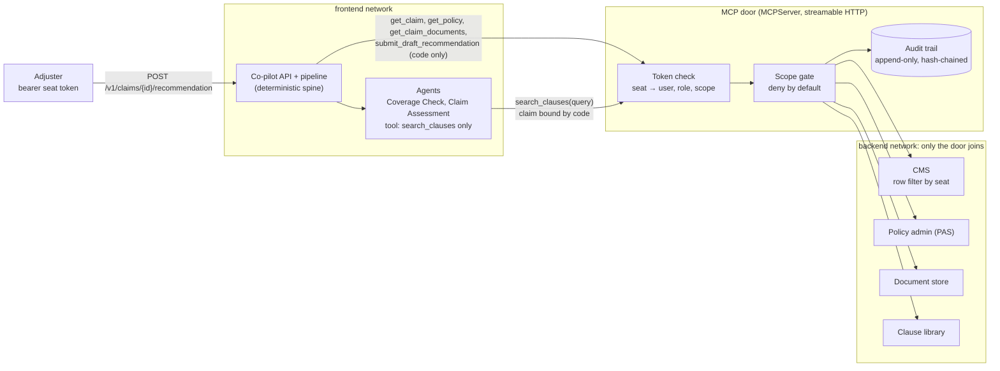

# The MCP door (Milestone 4)

The co-pilot reaches the client systems only through one governed MCP server, under the adjuster's own
token. The scope gate and the audit run in code inside the door, and the CMS filters rows again
underneath it. Decisions: D-031 to D-037. Matrix: [access-control.md](../engagement/access-control.md).

A denial is written to the audit trail before its structured error (`forbidden_scope`) goes back to the
API, which returns it to the caller as a 403.
